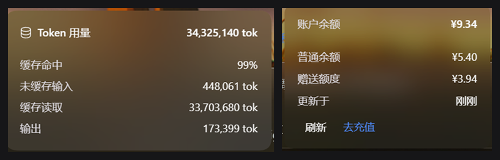

# 额度余额（Quota Balance）

在输入框下方的官方用量行左侧，显示当前登录账户的余额（¥）。



## 安装

需要 DSH 桌面版（Host 侧要有 `deepseekAccount` 服务）并已登录 DeepSeek 账号。

1. 把本仓库克隆或下载到本地任意目录；
2. 在 DSH 的插件管理里安装该目录：`install_bundle` 指向仓库路径；
3. 安装后即时生效，输入框下方的用量行最左侧会出现余额；点它展开明细。

卸载：在插件管理里移除 `@local/quota-balance` 即可。

## 结构

| 文件 | 作用 |
| --- | --- |
| `index.js` | Host 半边：注册 `GET /plugin/quota-balance/status`，通过 `deepseekAccount.getBalance()` 读取余额并做 30s（失败 5s）缓存 |
| `client.js` | Client 半边：往 `conversation.composer.dock` 注册一个 `order: -10` 的单元格（最左侧），每 60s、以及窗口重新可见时刷新 |
| `cordis.patch.yml` | 安装时插入 `quota-balance` 这一行 |
| `locale/*.json` | 插件在「插件」列表里的标题与描述 |

## 显示规则

- 同一币种的多个钱包（普通余额 + 赠送额度）合并求和，例如 `¥10.47`；多币种时用 ` · ` 连接。
- 点一下徽标在原地弹出一张小卡片（不跳转网页）：总余额、钱包分项、更新时间、「刷新」按钮；Host 侧返回 `normal`/`bonus` 后自动改成分「普通余额 / 赠送额度」两行，并出现「去充值」。
- `Esc`、点击卡片外部、再点一次徽标都会收起卡片。
- 卡片底边对齐徽标上方 6px，因此直接盖在输入框上（和官方 tok 浮层同一套读法），窗口缩放时重新贴靠。
- 未登录 / 读取失败时整块隐藏，不占位。
- 字体、颜色跟随用量行：`font: inherit`、12px、`--dsw-alias-label-tertiary`。
- 卡片挂在 `document.body` 上（`z-index` 最高）并用独立样式表，因为输入框卡片自带裁剪与层叠上下文，放在插槽里的悬浮层会被它盖住。

## 适配壁纸引擎（dsh-plugin-wallpaper-engine）

壁纸引擎不是给插件一套"浮层样式"，而是**把宿主自己的表面 token 就地改写成玻璃配方**（`--dsw-alias-bg-layer-*`、`--dsw-alias-bg-overlay`、`--dsw-alias-border-*` 全部重映射）。官方那些浮层（Token 用量、会话统计）读的就是这些 token，所以「抄壁纸插件的参数」最省事也最稳的做法是：**直接读同一个宿主 token**，让壁纸引擎自己去决定长什么样。

| 用途 | 取值 |
| --- | --- |
| 面板底色 | `var(--dsw-alias-bg-overlay, #26272b)`（与官方浮层同源，原样照抄） |
| 毛玻璃 | `backdrop-filter: blur(var(--we-blur, 13px)) saturate(var(--we-saturate, 1.3))` |
| 边框 | `--dsw-alias-border-l2`（壁纸引擎会同步重映射） |
| 文字 | `--dsw-alias-label-primary/secondary/tertiary` |
| 强调色（去充值） | `var(--we-accent, var(--dsw-alias-brand-primary, #7db3ff))` |

`--dsw-alias-bg-overlay` 单独用只有约 23% 的遮罩，所以卡片会把输入框里的文字淡淡透出来——按需求「数据原样照抄」，这里不做额外加暗。若哪天觉得碍眼，在 background 上垫一层 `linear-gradient(rgba(0,0,0,.22), rgba(0,0,0,.22))` 即可。

两个坑值记：`--dsw-alias-bg-base` 在壁纸引擎下是 `transparent`、`--dsw-alias-border-l1` 的 alpha 是 0；`--we-panel-color` 这类实色拿去铺底会变成不透明板子。

壁纸引擎未启用时 `--we-*` 回落、`--dsw-*` 回到宿主默认值，卡片就是普通深色浮层。

> 调试备忘：样式是注入到 `<style id="quota-balance-css">` 的，热更新时旧节点还在页面上——`injectPanelCss()` 必须**覆盖 `textContent`** 而不是发现节点就 return，否则改样式永远只生效第一版（这一坑排查了很久）。

## 接口

```
GET /plugin/quota-balance/status
{"ok":true,"wallets":[{"currency":"CNY","balance":"5.40"},...],"normal":[...],"bonus":[...],"links":{"usageUrl":"...","topUpUrl":"..."},"fetchedAt":1793627086526}
{"ok":false,"reason":"unavailable"|"signed-out"|"failed"}
```

余额只在本地回环地址上暴露，且响应不带 CORS 头，网页无法跨源读取。

## 改动后如何生效

- 改 `client.js`：保存后页面会热更新（本插件实测即时生效）。
- 改 `index.js`：在插件管理里把本插件**禁用再启用**即可重载 Host 模块，不必重启应用（已实测）；之后点卡片里的「刷新」取一次新数据。
